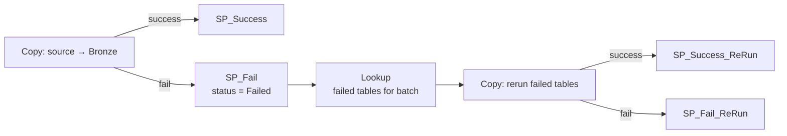
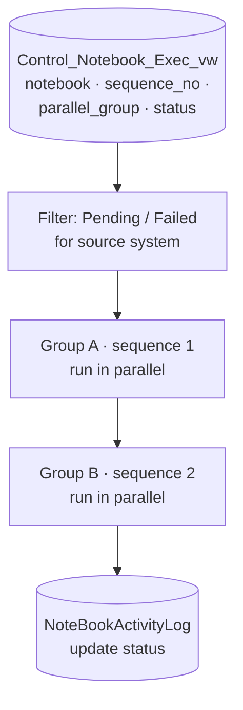
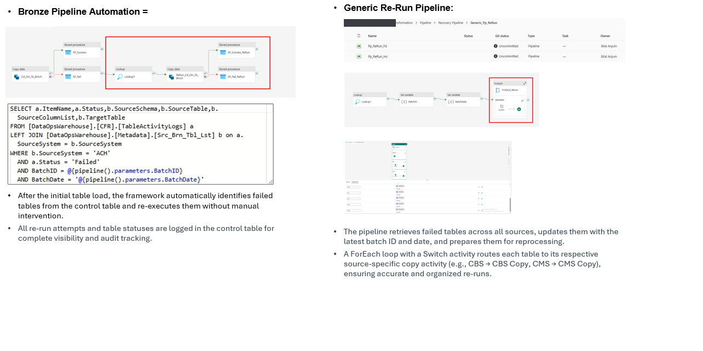
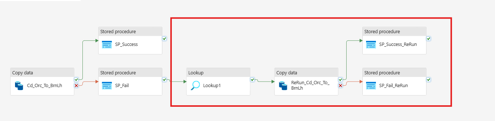
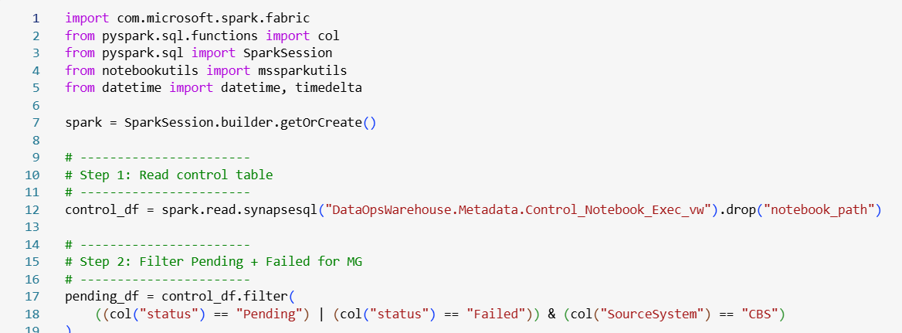
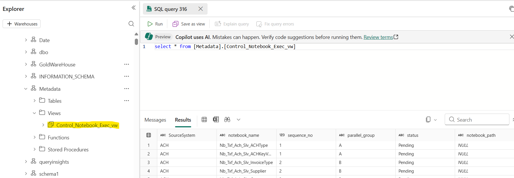
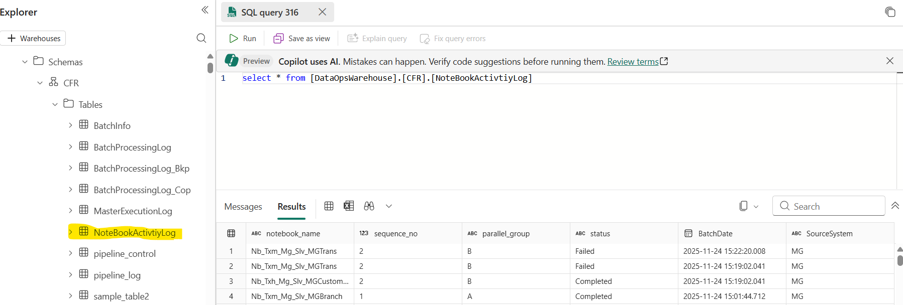

# Pipeline Rerun Framework for Microsoft Fabric

> A metadata-driven recovery framework that **finds failed tables and notebooks from control tables and re-runs them automatically** from their source systems. Major failures that used to take 4–6 hours to recover from now take less than an hour.

`Microsoft Fabric` · `Data Factory pipelines` · `Fabric Warehouse` · `Stored procedures` · `PySpark` · `Control tables` · `Switch / ForEach orchestration`

---

## Overview

In a daily batch platform loading many tables from several source systems, some loads will fail: network blips, source locks, timeouts. Before this framework, each failure had to be found in the logs, the table re-run by hand, and any dependent Silver notebooks restarted in the right order.

The **Pipeline Rerun Framework** builds on the control tables of the [Metadata-Driven Pipeline Framework](https://github.com/Bilal1850/fabric-metadata-driven-pipelines) and automates recovery at three levels: **Bronze tables**, **multi-source failures** and **Silver notebooks with dependencies**.

## The challenge

| Failure scenario | Manual recovery effort (before) |
|---|---|
| Re-running failed tables in a pipeline | ~30–60 min per pipeline |
| Failures across multiple sources | 1–2 hours to reprocess each one individually |
| Silver notebook dependency issues | High risk of delays, up to 4–6 hours for full recovery |

## Solution

### 1. Bronze pipeline auto-rerun
After the initial load, the Bronze pipeline queries the control table for tables marked `Failed` in the current batch, joins them to the metadata table to get schema, columns and target, and **re-copies only those tables**. Every rerun attempt and status is logged back to the control table for audit.

### 2. Generic rerun pipeline (multi-source)
A single recovery pipeline (`Pp_ReRun_Fd`, `Pp_ReRun_Inc`) retrieves failed tables **across all sources**, stamps them with the latest `BatchID` and `BatchDate`, and loops over them with **ForEach + Switch**. The Switch routes each table to its source-specific copy activity (CBS → CBS copy, CMS → CMS copy), so multi-source failures are handled in one step.

### 3. Silver notebook control
A control view (`Control_Notebook_Exec_vw`) lists each Silver notebook with its `sequence_no`, `parallel_group` and `status`. A control notebook selects notebooks that are `Pending` or `Failed` for a source system and **re-executes them in dependency order**, with independent notebooks running in parallel groups. Results are written to `NoteBookActivityLog`.

## How each question is answered

| Question | Answer in this framework |
|---|---|
| How are failures recorded? | Stored procedures write status per table (`TableActivityLogs`) and per notebook (`NoteBookActivityLog`), with `BatchID` and `BatchDate` |
| How are eligible items selected? | Status `Failed` (and `Pending` for notebooks), filtered by source system and current batch |
| How are reruns triggered? | Automatically, inside the Bronze pipeline after the first attempt. The generic rerun pipeline handles multi-source recovery, and a control notebook handles Silver |
| How do dependencies work? | `sequence_no` and `parallel_group` set the order. Notebooks in a group run in parallel, and groups run in sequence |
| How is success verified? | Rerun outcomes are logged (`SP_Success_ReRun` / `SP_Fail_ReRun`, notebook status updates), giving a complete audit trail |

## Results

| Area | Impact |
|---|---|
| Bronze pipeline automation | Failed tables reprocessed automatically: **~90% less manual intervention** |
| Generic rerun pipeline | Multi-source failures handled in one step: **70–80% faster recovery** |
| Silver notebook control | Dependency-managed auto re-execution: **50–60% less downtime** |
| Major-failure recovery time | **From 4–6 hours to under 1 hour** |
| Operational overhead | **Reduced by 60–70%** |
| Data completeness | Near-100% assurance without manual checks |
| Governance | Faster SLA compliance and more stakeholder confidence |

## Code samples

| File | Description |
|---|---|
| [`samples/failed_tables_lookup.sql`](samples/failed_tables_lookup.sql) | Finds failed tables for the current batch and joins their copy metadata |
| [`samples/silver_rerun_control.py`](samples/silver_rerun_control.py) | Silver control-notebook excerpt: reads the control view and selects Pending/Failed notebooks |

## Screenshots

| Overview | Bronze auto-rerun |
|---|---|
|  |  |
| Bronze automation and generic rerun pipeline | Rerun branch (highlighted) after a failed copy |

| Silver control notebook | Notebook control view |
|---|---|
|  |  |

| Notebook activity log |
|---|
|  |

## Business value

Data arrives on time without someone watching every run. Recovery that used to take a morning of manual work now happens automatically, which protects reporting SLAs and frees engineers for higher-value work.

## My role

I designed and built the rerun framework: the failure-detection queries, the automatic Bronze rerun branch, the generic multi-source rerun pipeline and the dependency-aware Silver notebook control.

---
Client name and workspace details have been removed. Impact figures are the project team's operational estimates.
